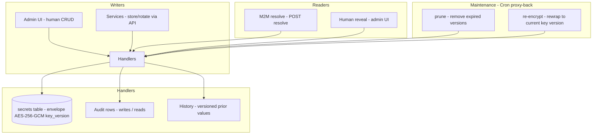

# Design Doc: Sentin8:Secrets - Secret Reference Store & Resolver

## 1. Summary

Sentin8:Secrets is the platform's secret-reference store and resolver.
Secrets (provider keys, OAuth client credentials, callback tokens) are
stored encrypted (AES-256-GCM envelope, key-versioned) and surfaced
only via two controlled paths: an M2M machine resolve
(`POST /v1/secrets/resolve`) and a human reveal (audited). Metadata is
value-free; every read is audited; maintenance (prune, re-encrypt)
runs via Cron proxy-back.

## 2. Motivation

- **Secret references only.** Application tables store
  `backend://path` references, never credential material - a database
  dump or backup must never contain a usable provider key, PAN, PIN,
  or OAuth client secret.
- **Two access paths, both audited.** Machines resolve values
  programmatically (with a work-load-scoped token); humans reveal for
  inspection - both write `reads` audit rows. An unaudited reveal is
  the classic secret-store failure.
- **Zeroize-on-drop plaintext.** Plaintext values live only inside
  request/response handling (the `SecretValue` wrapper zeroes on
  drop); metadata projections never serialize values.
- **Key rotation without downtime.** Value ciphers carry a key version;
  re-encrypt is a manual maintenance operation (admin endpoint) that
  rewraps rows to the current key while old-version rows stay readable,
  and the daily version-prune schedule (Sentin8:Cron, registered at
  boot) holds the rotation window without a user request.

## 3. Architecture & High-Level Design

- **Tenant context** - resolved from the auth token's `env_id` claim
  (globally unique), never from URL path segments; cross-env access is
  validated at the authorization layer.
- **Envelope** - `value_cipher` BYTEA carries the AES-256-GCM envelope
  (`v2:` prefix via `sentin8-crypto`) with a `key_version` column;
  `SENTIN8_AUTH_MASTER_KEY` is the master key source (same source as
  auth signing keys), with a dev-only deterministic key escape hatch
  for tests.
- **Reveal audit** - every M2M resolve and human reveal records who,
  what, and when (`reads` table surfaced in the admin UI history
  page).
- **Rotation** - `rotate_secret` bumps the version and retains the
  previous one until the prune window; resolve returns the active
  version.

## 4. Key Traits and Data Structures

- **`SecretRow`** - the stored record: id, name, description,
  `value_cipher` (envelope bytes), `key_version`, `version`, status,
  creator, env, timestamps - with a `metadata()` projection that
  NEVER includes the value.
- **`UpsertSecretRequest`** - create/update: name (validated: admin
  charset), description, plaintext value (accepted once, encrypted
  immediately).
- **`ResolveRequest` / `ResolveResponse`** - the M2M contract: name →
  plaintext value (returned once, never logged).
- **Maintenance handlers** - `prune` (remove expired versions) and
  `re-encrypt` (rewrap to the current key version). The daily
  `secrets-version-prune` schedule (registered at boot, 05:30) drives
  prune through the Cron proxy-back `/v1/internal/schedules/run`
  (`schedule_type: version-prune`); re-encrypt stays manual.

## 5. Rationale, Trade-offs, and Alternatives

- **Envelope encryption with versioned keys.** `value_cipher` is raw
  envelope bytes (`sentin8-crypto`); the version column lets old rows
  decrypt during rotation and re-encrypt lazily. Plaintext-at-rest or
  app-layer-only hashing would both fail the model (secrets must be
  recoverable for providers).
- **Two reveal paths, both audited.** Machines resolve (the common
  path, token-scoped); humans reveal rarely. Every reveal writes an
  audit row - a secret read without a record is a compromise signal
  missed. The alternative (unaudited reads) fails compliance review.
- **Tenant context from claims only.** URL path segments are attacker-
  controlled; the token's `env_id` (globally unique, TLS-verified) is
  the tenant key. Cross-env requests are validated at the
  authorization layer, never defaulted.
- **Metadata value-free by construction.** The `metadata()` projection
  and list endpoints serialize only id/name/description/version/status
  - a future field addition cannot accidentally leak the cipher text
  because the value never enters the projection.
- **Rotation via versioning, not overwrite.** The previous version is
  retained until the prune window: consumers mid-upgrade keep
  resolving; the active pointer flips atomically. Hard overwrites
  break readers that cached the old value.
- **Maintenance via Cron proxy-back.** Prune is scheduled by
  Sentin8:Cron (the daily `secrets-version-prune` schedule registered
  at boot, 05:30) and calls back the internal proxy-back endpoint -
  the service owns its domain logic; Cron owns the clock. Re-encrypt
  stays a manual post-rotation step.
- **Zeroize-on-drop `SecretValue`.** Plaintext buffers are wiped when
  dropped; logs and error messages never carry values (a panic message
  with a key would otherwise leak it to logs).
- **Rejected: environment-variable-only secrets.** Unversioned,
  unrotatable, unaudited, and invisible to the admin UI; the store
  gives all four.
- **Rejected: Vault-style external system.** An additional failure
  domain and identity plane; the platform's own store keeps identity,
  audit, and RLS consistent.

## 6. Internal Implementation & Invariants (Private Design)

- **Invariants:**
  - Plaintext secret values exist ONLY inside request/response handling
    (zeroize-on-drop); no value ever persists outside the envelope.
  - The metadata surface never serializes `value_cipher` or plaintext.
  - Every reveal (M2M or human) writes a `reads` audit row before the
    response returns.
  - Names are validated (`validate_name_admin`): charset, length,
    reserved prefixes - rejection is fail-closed.
  - Rotation retains the previous version until the prune window;
    `maintenance_prune` (Cron proxy-back) removes expired versions.
  - Re-encrypt rewraps rows to the current key version; old-version
    rows remain readable during the transition (rotation never
    bricks).
  - RLS context is set on the same connection inside the same
    transaction as every secret read/write (transaction-local).
- **Boot (shell-owned).** The shell owns the listener stack; Secrets
  builds its capped pool, consumes the Shield engine, and mounts the
  API, admin UI (with the shared policy-admin surface), and
  maintenance proxy-back routes.
- **History page.** The admin UI exposes per-secret version history
  and the `reads` audit trail; reveals are visible and
  operator-attributable.

## 7. Unresolved Questions / Future Designs

- Hardware-backed key storage models as another `KeyProvider` impl behind the
  existing master-key seam.
- Per-scope secret ACLs keep scope-gating as the contract (a
  `sentin8:secrets:{scope}:read` scope per scope).
- Secret sharing (split-knowledge) is a non-goal: Shamir-split master keys add
  operational ceremony without a consumer.

---

**Architecture & Design:** sentin8:secrets and its underlying concepts were designed by [Hamid Jahanzad](https://www.linkedin.com/in/hamidjahanzad/).
