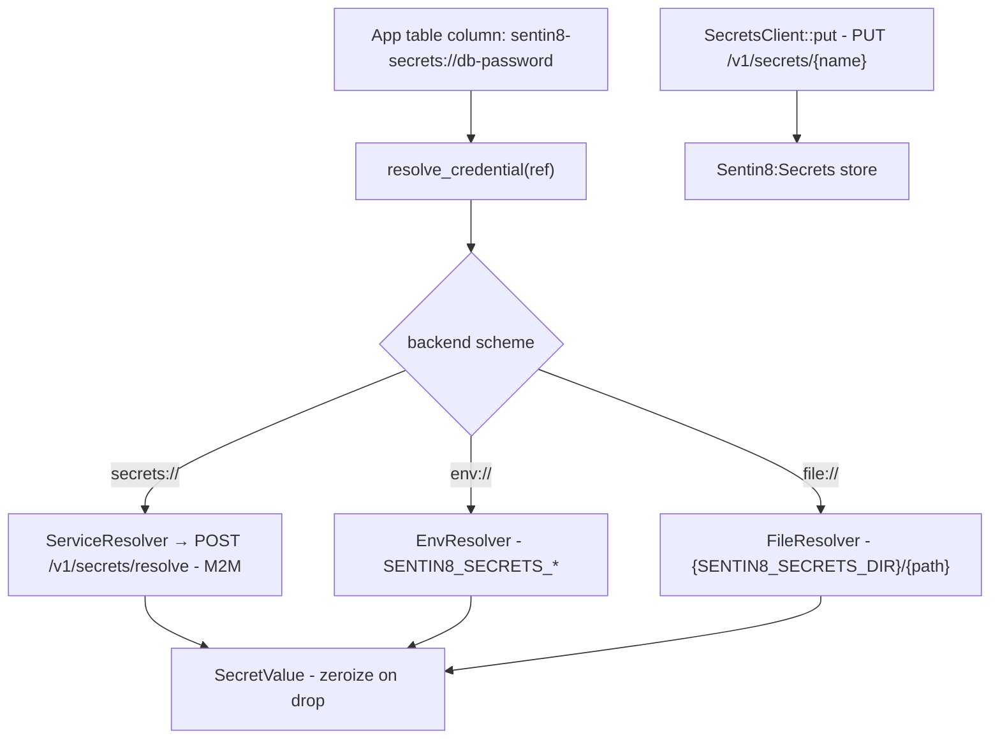

# Design Doc: sentin8-secrets (Secret References & Resolution)

## 1. Summary

`sentin8-secrets` defines the platform's secret-reference model and the
resolver surface services use to turn a stored reference into a live
secret value. Application tables hold only `backend://path` references;
plaintext secret material lives in the backing store (Sentin8:Secrets
service, env vars, or files) and is resolved at use time into a
zeroize-on-drop value.

## 2. Motivation

- **Plaintext secrets are the default leak.** DB dumps, backups, logs, and
  ORM debug output all capture column values. Storing a reference string
  instead makes ordinary tables safe by construction; the secret only
  exists in memory at the moment of use.
- **One URI convention.** `vault://…`, `secrets://…`, `env://…`,
  `file://…` give every service a uniform reference format regardless of
  which backend holds the material.
- **Developer and production paths.** Dev bootstraps resolve against env
  vars and local files; production resolves over the authenticated
  Sentin8:Secrets service - the same code path, different backend.

## 3. Architecture & High-Level Design

- **`SecretRef`** - the stored reference: backend + path, rendering as a
  `backend://path` URI for text columns and parsing back losslessly.
- **`SecretValue`** - the in-memory plaintext: bytes are zeroized on drop;
  `into_string` validates UTF-8 while zeroizing the working copy.
- **Resolvers** - `EnvResolver`, `FileResolver` (with a traversal guard),
  and `ServiceResolver` (the HTTP path via `SecretsClient`).
- **`resolve_credential`** - the one-call dispatch every consumer uses.

## 4. Key Traits and Data Structures

- **`SecretResolver`** - the async resolution contract
  (`resolve(ref) → SecretValue`); each backend implements it, so callers
  are backend-agnostic.
- **`SecretRef`** - `{ backend, path }` with URI round-trip helpers;
  parsing rejects malformed refs (missing scheme, empty halves).
- **`SecretValue`** - owned bytes with a `Drop` that scrubs memory.
- **`SecretsClient`** - the HTTP client for the production backend:
  `resolve` (POST, 404 → `NotFound`) and `put` (upsert + version bump -
  the machine write path for DCR credential persistence), with a static
  token or a per-call M2M token source.
- **`SecretError`** - invalid ref, not-found, invalid UTF-8, backend
  failure.

## 5. Rationale, Trade-offs, and Alternatives

- **Reference-in-column over encryption-at-rest-in-column.** Referencing
  removes the secret from the DB entirely - an attacker with full DB
  access still needs the backend. The AES envelope codec
  (`sentin8-crypto`) covers the rows that must remain self-contained;
  references cover everything provisioned externally.
- **Scheme-based dispatch.** The URI scheme is the router; adding a
  backend is one match arm. A registry table would add a lookup for no
  flexibility gain at three backends.
- **`env://` dev backend.** Captain already distributes bootstrap
  configuration via process env; `env://` reuses that channel for dev
  secrets without a running service. It is not the production path - env
  secrets are process-global and unscoped.
- **File backend with a traversal guard.** Relative paths resolve under
  `SENTIN8_SECRETS_DIR`; absolute paths and `..` components are refused
  (the same `safe_path` pattern the storage adapter uses), so a malicious
  reference cannot escape the secrets directory.
- **M2M token per call.** The client prefers the token source and falls
  back to the static token only on fetch failure - secrets reads stay
  available during token-source outages while normally using short-lived
  credentials.
- **Zeroize-on-drop `SecretValue`.** The resolved plaintext lives exactly
  as long as the caller needs it; copies are scrubbed. It cannot protect
  against a compromised process, but it bounds exposure in swap/core
  dumps.
- **Rejected: caching resolved secrets.** Caching would extend plaintext
  lifetime and complicate revocation; resolves are cheap HTTP calls.

## 6. Internal Implementation & Invariants (Private Design)

- **Invariants:**
  - A `SecretRef` URI round-trips: `parse(to_uri(r)) == r`.
  - `SecretValue` bytes are zeroed on drop; `into_string` consumes the
    value (no plaintext copies outlive it beyond the caller's string).
  - `FileResolver` never escapes its root: absolute paths, `..`, and root
    components are `InvalidRef` errors.
  - The service resolver maps HTTP 404 to `NotFound` distinctly from
    backend failure - callers can distinguish stale references.
  - Plaintext never enters logs: the client logs statuses, not bodies.
- **Standard chain.** `resolve_credential` recognizes
  `secrets://`/`service://`/`sentin8-secrets://` (aliases), `env://`, and
  `file://`; anything else is an error rather than a guess.
- **Endpoint contract.** Resolve is POST with a `ref` body (no secret in
  the URL); put is PUT by name with upsert + version bump semantics.

## 7. Unresolved Questions / Future Designs

- Vault/AWS-SM backends stay unimplemented until a deployment requires it: the
  ref-scheme registry is the seam.
- Rotation (re-reference or in-place value rotation with version pinning)
  adopts the KeyRing pattern (decrypt-old → encrypt-new re-wrap) when a
  rotation story lands.
- Per-tenant secret namespacing stays implicit in the reference path
  (`{service}/{scope}/{name}`) as the contract.

---

**Design attribution:** sentin8:secrets and its underlying concepts were designed by Hamid Jahanzad <Hamid@Jahanzad.com>.
